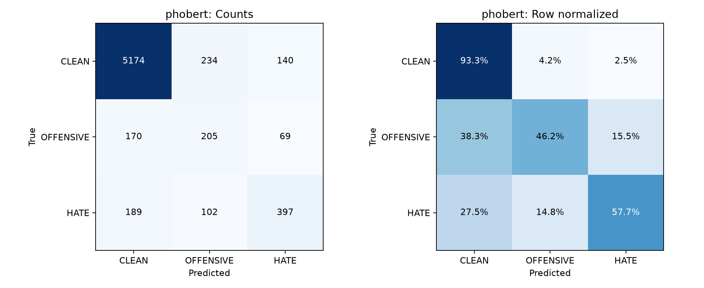

# Stage 3 — Đánh giá test và phân tích lỗi

Model khóa từ validation: `phobert_lr3e-5_len128_drop01_batch16_seed42`. Test: 6,680 mẫu, seed huấn luyện 42.
Inference thực hiện local bằng checkpoint và baseline đã huấn luyện trên Colab; không fit lại.

| Model | Test Macro-F1 | Weighted-F1 | Accuracy |
|---|---:|---:|---:|
| baseline | 0.632496 | 0.849376 | 0.843563 |
| phobert | 0.654565 | 0.866463 | 0.864671 |

## Precision / recall / F1 theo lớp (PhoBERT)

| Lớp | Precision | Recall | F1 | Support |
|---|---:|---:|---:|---:|
| CLEAN | 0.9351 | 0.9326 | 0.9339 | 5548 |
| OFFENSIVE | 0.3789 | 0.4617 | 0.4162 | 444 |
| HATE | 0.6551 | 0.5770 | 0.6136 | 688 |

## Phân tích lỗi

Tổng 904 dự đoán sai. Các hướng nhầm (nhãn thật → dự đoán):
- CLEAN → OFFENSIVE: 234 mẫu.
- HATE → CLEAN: 189 mẫu.
- OFFENSIVE → CLEAN: 170 mẫu.
- CLEAN → HATE: 140 mẫu.
- HATE → OFFENSIVE: 102 mẫu.
- OFFENSIVE → HATE: 69 mẫu.

Các lát cắt chẩn đoán (Macro-F1 luôn tính đủ ba lớp; lát cắt nhỏ cần thận trọng):

| Lát cắt | Số mẫu | Số sai | Macro-F1 |
|---|---:|---:|---:|
| all | 6680 | 904 | 0.6546 |
| validation_overlap | 95 | 8 | 0.7187 |
| no_validation_overlap | 6585 | 896 | 0.6536 |
| tokens_0_32 | 6219 | 806 | 0.6450 |
| tokens_33_128 | 458 | 97 | 0.5949 |
| tokens_over_128 | 3 | 1 | 0.5556 |

## Độ bất định và giới hạn

Paired bootstrap 2.000 lần, seed 42: CI 95% Macro-F1 PhoBERT [0.6359636033169934, 0.6728372935338658]; chênh lệch PhoBERT − baseline [0.002595712817171478, 0.04180102913999858].
Bootstrap theo dòng giả định mẫu độc lập; duplicate/ngữ cảnh chung có thể làm CI quá hẹp. Không đo biến thiên qua seed huấn luyện.
Test chính thức giữ nguyên; lát cắt bỏ overlap validation chỉ là phân tích độ nhạy, không thay điểm test chính.
Softmax confidence chưa được hiệu chuẩn. Không suy luận nguyên nhân ngôn ngữ hay nhãn sai chỉ từ confusion matrix.
`error_review.csv` chứa tối đa 10 lỗi confidence cao mỗi hướng nhầm, để người học xem ngữ cảnh và ghi nhận xét; không đại diện ngẫu nhiên cho toàn bộ lỗi.
Không sửa nhãn test, không chọn lại checkpoint/threshold/hyperparameters từ kết quả này. Chưa chứng minh chất lượng production.

## Đối chiếu quá trình học

Best epoch theo validation: 5; validation Macro-F1 0.684326, test Macro-F1 0.654565.
Train loss giảm từ 0.9219 xuống 0.3055; validation loss thấp nhất 0.8057, cuối cùng 1.6326.
Loss validation tăng trong khi train loss giảm là dấu hiệu overfitting; Macro-F1 vẫn tăng nên checkpoint epoch 5 đúng tiêu chí chọn đã khóa. Không đổi checkpoint sau khi xem test.

## Môi trường baseline

Baseline được serialize bằng scikit-learn 1.6.1 trên Colab; lần inference local dùng 1.9.1 và có cảnh báo khác phiên bản. C và validation Macro-F1 đã được kiểm tra lại trước test; không fit lại baseline. Nên dùng 1.6.1 khi tái lập môi trường gốc.
